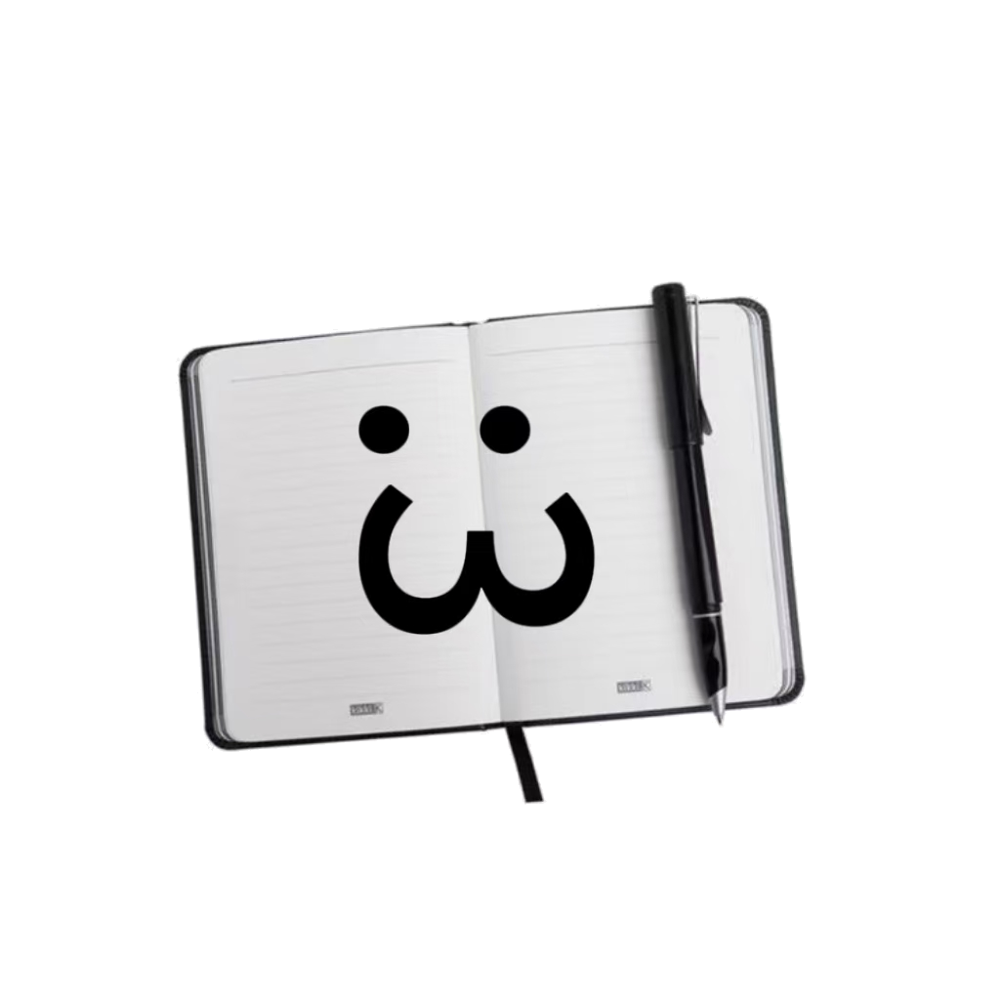
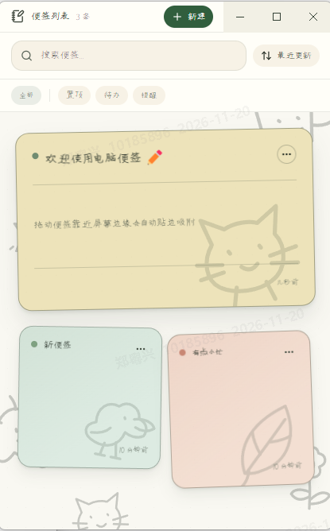
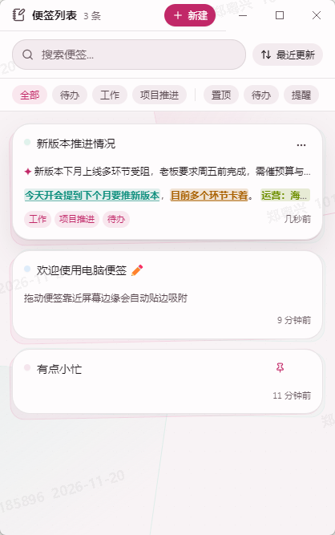
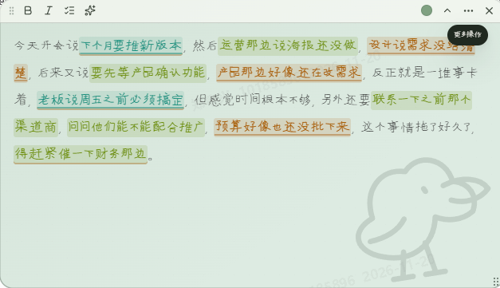
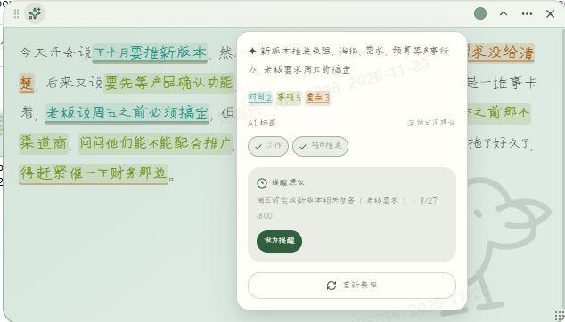
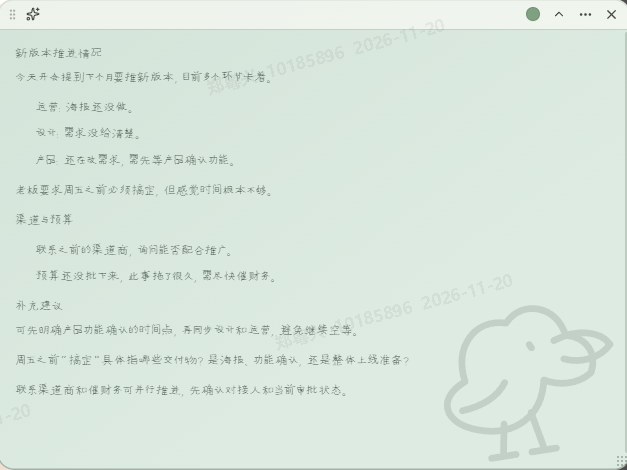
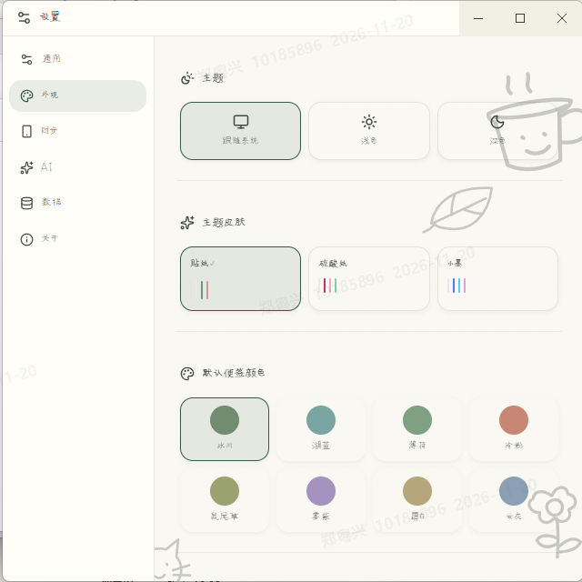

# 📓 贴记 · Pinote

当前项目作者：handsomelittlexing。

> 三套皮肤的跨端便签：桌面常驻、手机随手记、多端同步，还能用 AI 整理并补充内容。

<p align="center">
  
  
  
  
  
  
  
  
</p>

---

## 应用图标

桌面端与手机端的图标均由 嘟嘟🐔 设计，分别使用纸团笑脸与笔记本笑脸。

| Windows 桌面端 | Android 手机端 |
| --- | --- |
|  |  |

---

## 界面截图

以下截图来自 Windows 桌面端，展示贴记当前的实际界面。

### 便签列表与三种皮肤

| 贴纸：错落纸片与手绘插画 | 硫酸纸：柔和的半透明层次 | 小墨：圆润的浅紫卡片 |
| --- | --- | --- |
|  |  |  |

列表支持搜索、标签筛选和按最近更新排序。打开便签后，可以把它留在桌面上，拖动、缩放或置顶；三种皮肤均可切换明暗模式。

### 编辑便签与 AI 整理

| 在便签中编辑并查看 AI 标注 | 查看摘要、标签和提醒建议 |
| --- | --- |
|  |  |

AI 可以标出时间、人物和重点句，并给出标签与提醒建议。整理并补充会先展示预览，由你选择是否应用到正文。

| AI 整理后的预览 | 外观设置 |
| --- | --- |
|  |  |

---

## 这是什么

贴记（Pinote）是一套**私人便签系统**，由三个部分组成：

| 部分 | 形态 | 职责 |
|------|------|------|
| 桌面端 | Electron 应用（Windows） | 便签常驻桌面，随手一贴；本地优先存储 |
| 手机端 | Expo / React Native（Android） | 随时随地查看、编辑、新建便签 |
| 同步后端 | Node.js + Express + MySQL | 无账号体系，用配对码把设备并入同一个「同步空间」 |

设计目标是**不打扰**：便签贴在桌面边缘、点开即写；需要跨设备时再打开同步，数据仍然优先保存在本地。

界面提供三套可切换的皮肤，每套都有明亮 / 暗黑两态：

| 皮肤 | 视觉语言 |
|------|----------|
| **贴纸 Sticker Paper** | 奶油白纸底、深墨手写字、浅彩纸片与原创拙趣简笔画 |
| **硫酸纸 Vellum** | 雾白或近黑底、叠层半透明纸、玫红/薄荷墨色、细噪点 |
| **小墨 Mote** | 奶油紫底、圆润卡片、会眨眼和看向你的珠光墨团 |

AI 标注会把便签里的**时间 / 地点 / 人物 / 事项 / 重点句**非破坏性地标出来，不改正文。独立的「AI 整理并补充」可预览整理稿、逐条选择补充建议；只有点击应用才替换正文，并可在当前编辑会话撤销一次。

> 项目内部沿用历史标识：`sticker-note`、`com.stickernote.*`，以兼容已有数据和升级安装。

---

## 功能

### 桌面端

| 功能 | 说明 |
|------|------|
| 🪟 桌面便签窗口 | 独立无边框窗口，可拖动、缩放、贴边吸附 |
| 📐 折叠 / 展开 | 折叠成一条标题栏，不遮挡桌面；标题栏右键可直接换色 |
| ✏️ 富文本 | 加粗、斜体、列表、待办清单、字号、字体颜色 |
| 🎨 8 种冷色 | 冰蓝 / 湖蓝 / 薄荷 / 玫瑰 / 鼠尾草 / 丁香 / 霜白 / 云灰（兼容旧色值自动映射） |
| 📌 置顶与透明度 | 便签始终置顶，透明度 20%–100% |
| ⏰ 定时提醒 | 快捷提醒（30 分钟 / 1 小时 / 明天）与自定义时间 |
| 🏷️ 标签与搜索 | 自定义标签、按标签筛选、全文搜索 |
| 🗑️ 软删除与恢复 | 删除进入回收站，可随时恢复 |
| ⌨️ 全局快捷键 | 默认 `Ctrl+Alt+N` 新建、`Ctrl+Alt+S` 打开列表，可在设置中录制修改 |
| 🚀 开机自启 | 写入注册表，开机自动显示 |
| 🔕 系统托盘 | 关闭窗口不退出；托盘菜单快速新建 / 打开列表 / 退出 |
| 🌙 深色模式 | 跟随系统 / 浅色 / 深色 |
| 🎨 三套皮肤 | 贴纸 / 硫酸纸 / 小墨，每套都有明暗两态 |
| ✦ AI 标注与整理 | 标注生成摘要、少量标签和提醒建议；整理补充可预览并选择后改正文 |
| 💾 导入导出 | JSON 备份与恢复 |

### 手机端

- 便签列表：搜索、标签筛选、置顶 / 提醒筛选、下拉刷新同步
- 富文本编辑：加粗、斜体、列表，400 ms 防抖自动保存
- 三套皮肤 × 明暗模式，可在设置页随时切换
- ✦ AI 标注：摘要、标签、注解预览、提醒建议；AI 整理并补充需预览确认后才改正文
- 扫码或输入配对码完成配对，无需登录
- SQLite 本地缓存，离线可读可写

- 手机系统通知提醒：可在便签管理中设置、修改或取消；点击通知直达便签
- 列表长按管理置顶、标签和提醒，最近删除可恢复
- AI 待办可逐条加入便签清单并勾选；搜索框可手动发起语义查找（最近 80 条）

### 多端同步

- **本地优先**：两端都以本地数据为日常读写对象，联网时增量双向同步
- **最后写入优先（LWW）**：同一条便签冲突时以 `updatedAt` 较新者为准
- **软删除**：删除以 tombstone 同步，多端一致
- **多设备**：每台设备独立 token，可同时配对多部手机
- **默认关闭**：同步需要在设置中手动开启

---

## 架构

```
┌────────────────────┐        HTTP / HTTPS        ┌─────────────────────────────┐
│  桌面端 (Electron)   │ ────────────────────────► │  同步后端 (Node + Express)    │
│  electron-store     │          /sync            │        │                    │
│  SyncManager        │                           │        ▼                    │
└────────────────────┘                           │  MySQL (sticker_note_sync)  │
                                                 │                             │
┌────────────────────┐        HTTP / HTTPS        │  · sync_spaces              │
│  手机端 (Expo RN)    │ ────────────────────────► │  · devices（token 哈希）      │
│  SQLite + AsyncStorage                        │  · pairing_codes            │
│  syncClient         │                           │  · stickers（软删除）         │
└────────────────────┘                           └─────────────────────────────┘
```

- 两端共用 `src/shared/` 下的类型定义、冷色板与文本工具，避免字段漂移
- 后端只保存 token 的 SHA-256 哈希；配对码 6 位、5 分钟有效、仅可使用一次

---

## 技术栈

| 层 | 技术 |
|----|------|
| 桌面外壳 | Electron 28 · electron-vite · electron-store · electron-builder |
| 桌面 UI | React 18 · TypeScript · Tailwind CSS · Radix UI · lucide-react |
| 富文本 | Tiptap（桌面）· react-native-pell-rich-editor（手机） |
| 手机端 | Expo SDK 58 · React Native 0.88 · React Navigation · expo-blur · expo-sqlite |
| AI | DeepSeek（OpenAI 兼容接口）；单端设备直连，互通模式由服务器代理 |
| 同步后端 | Node.js 20 · Express · MySQL 8 · tsx |
| 部署 | Nginx / systemd 或 Docker，详见 [部署指南](docs/DEPLOYMENT.md) |

---

## 快速开始

### 三种使用模式

| 模式 | 需要安装 | 便签保存与同步 | 如需使用 AI |
| --- | --- | --- | --- |
| **仅电脑** | Windows 桌面端 | 保存在电脑本地；无需部署服务器或配对 | 设置 → AI →「本机直连」，填入自己的 DeepSeek Key |
| **仅手机** | Android 手机端 | 保存在手机本地；无需部署服务器或配对 | 手机设置 → AI →「本机直连」，填入自己的 DeepSeek Key |
| **手机电脑互通** | 两端应用 + 自建同步后端 | 两端本地读写，配对后经服务器增量同步 | 两端可选「同步空间」并共用空间 Key，也可各自选「本机直连」 |

单端模式安装后即可记便签；AI 是可选功能。想互通时，在电脑的「手机同步」设置中填写服务器地址并开启同步，再用手机扫描二维码或输入配对码。服务器地址由使用者自行配置，项目没有预置个人同步服务器。

「本机直连」指设备通过网络直接请求 DeepSeek，并非离线运行模型。只有手动触发 AI 时才发送所需的便签纯文本；本机 Key 留在当前设备，同步空间 Key 由自建服务器保存。项目源码与发行包不包含开发者 API Key。

### 环境要求

- Node.js 20+、npm
- 桌面端：Windows 10/11 x64
- 手机端：Android SDK / JDK 17（本地构建 APK 时需要）；Expo Go 预览则无需

### 桌面端

```bash
npm install
npm run dev        # 开发模式（渲染进程热更新）
npm run typecheck  # 类型检查
npm run build      # 打包 NSIS 安装包 -> release/
```

未签名的安装包位于 `release/贴记-Setup-<version>.exe`。

### 同步后端

```bash
cd server
cp .env.example .env   # 填写 DB_HOST / DB_USER / DB_PASSWORD 等
npm install
npm run db:init        # 创建数据库与表结构
npm run db:migrate     # 已有数据库：补 ai、tasks 列（幂等）
npm run dev            # http://localhost:4000，健康检查 /health
```

互通模式的 AI Key 可在已配对的桌面或手机设置页填写，同一同步空间共用；服务器需要 `AI_CREDENTIALS_MASTER_KEY` 加密保存，Key 配置入口需要 HTTPS（直连 localhost 开发例外）。旧 `LLM_API_KEY` 仍可作为服务器默认 Key。没有 Key 时可设 `AI_MOCK=1` 本地联调；生产环境不要开启 Mock。

生产部署（ECS、systemd、HTTPS、升级回滚）见 [docs/DEPLOYMENT.md](docs/DEPLOYMENT.md) 与 [server/deploy/README.md](server/deploy/README.md)。

也可以直接用 Docker：

```bash
cd server
docker build -t stickernote-sync .
docker run -d --env-file .env -p 4000:4000 stickernote-sync
```

### 手机端

```bash
cd mobile
npm install

npx expo start          # 预览界面与同步
npx expo prebuild --platform android   # 首次或原生配置变更后
npx expo run:android    # 本地开发构建

# 打 release APK（arm64）
cd android
./gradlew assembleRelease -PreactNativeArchitectures=arm64-v8a
adb install -r app/build/outputs/apk/release/app-release.apk
```

`mobile/android`、`mobile/ios` 为 `npx expo prebuild` 生成的原生工程，不纳入版本控制。

---

## 配对与同步

1. 桌面端 **设置 → 手机同步**，开启同步并生成 6 位配对码
2. 手机端首次启动进入配对页：填写服务器地址后输入配对码，或扫描桌面端二维码
3. 配对成功后，设备获得独立 token，两端进入同一个同步空间
4. 之后：手机打开列表 / 下拉刷新 / 手动同步；桌面端在开启同步后自动同步
5. 在任一设备修改便签，另一端下次同步即可看到

冲突策略为最后写入优先；同步空间与设备可在桌面端设置中管理。

---

## 数据与隐私

- 同步**默认关闭**，不开启时所有数据只存在本机
- 桌面数据保存在 `%APPDATA%/sticker-note/`（electron-store JSON）
- 手机数据保存在 SQLite + AsyncStorage
- 服务端仅保存 token 哈希，不保存明文凭据；配对码短时有效且单次使用
- 后端是个人自建服务，除配对与同步接口外不采集任何数据
- **AI 整理只在手动触发时**发送当前便签纯文本：设备来源直接发给 DeepSeek，互通来源经同步服务器发给配置的模型。手机语义查找也只在手动触发时发送最近最多 80 条便签各最多 300 字的纯文本。不会自动分析，不发送图片。AI 结果作为便签字段可随便签同步
- 设备 Key 仅保存在当前设备的系统安全存储中，不进入备份和同步；卸载手机应用后需要重新填写
- 服务器日志只记录 AI 请求的字数、耗时与状态，不记录便签正文

---

## 目录结构

```
.
├─ src/                       # 桌面端（Electron）
│  ├─ main/                   # 主进程：窗口、托盘、快捷键、提醒、同步、存储
│  ├─ preload/                # contextBridge 暴露的 API
│  ├─ renderer/               # React 渲染进程：便签窗口 / 列表 / 设置
│  └─ shared/                 # 两端共用：类型、皮肤、AI 标注、文本工具
├─ mobile/                    # 手机端（Expo / React Native）
│  ├─ App.tsx
│  └─ src/
│     ├─ screens/             # 配对 / 列表 / 编辑 / 设置
│     ├─ components/          # 玻璃表面、标注文本、小墨等
│     ├─ api/                 # 同步 / AI 客户端与配对
│     ├─ hooks/               # 页面逻辑
│     ├─ storage/             # SQLite 与外观偏好
│     └─ theme.tsx            # 三皮肤 × 明暗 token
├─ server/                    # 同步后端
│  ├─ src/routes/             # pairing / devices / sync / ai
│  ├─ src/db/                 # schema、初始化与迁移
│  ├─ Dockerfile
│  └─ deploy/                 # ECS 部署脚本与 systemd unit
├─ docs/                      # 架构、设计、实现与部署文档
├─ resources/                 # 图标等打包资源
├─ electron-builder.yml
└─ package.json
```

---

## 文档

- [同步与移动端架构](docs/SYNC-ARCHITECTURE.md)
- [部署指南](docs/DEPLOYMENT.md)
- [打包指南](docs/PACKAGING.md)
- [UI 改版方案](docs/UI-REDESIGN-PLAN.md)
- 分阶段设计与实现记录：[docs/design](docs/design) · [docs/implementation](docs/implementation)
- [Phase 4：三皮肤 + AI 标注（含已移除的语音功能记录）](docs/implementation/2026-10-26-phase4-themes-ai-voice-implementation.md)

---

## 已知限制

- 桌面端仅支持 Windows（macOS / Linux 未适配）
- 手机端目前只构建 Android；iOS 需要 macOS 环境
- 同步为单用户同步空间，无账号与权限体系
- 冲突策略为最后写入优先，不合并同一便签的并发编辑
- 列表卡片使用预合成不透明底色（Android「半透明 + elevation」渲染瑕疵的规避方案）
- AI 整理需要网络和有效 Key：单端模式使用本机直连；互通模式可选择同步空间 Key。没有网络时不调用
- AI 结果是原文的精确子串匹配，正文改动后旧结果会自动隐藏，需要重新整理
- AI 与正文共用 `updatedAt` 做最后写入优先；冲突时以较新的正文为准，AI 可重新生成

---

## License

[MIT](LICENSE)

界面字体使用[莲生灵光体](https://github.com/kim-wing/liansheng-lingguangti) 2.2.11（作者：莲生）。字体依其 Arphic Public License 分发；原始字体、授权条款及上游声明见 [resources/fonts](resources/fonts)。项目代码的 MIT 许可不覆盖该字体。
