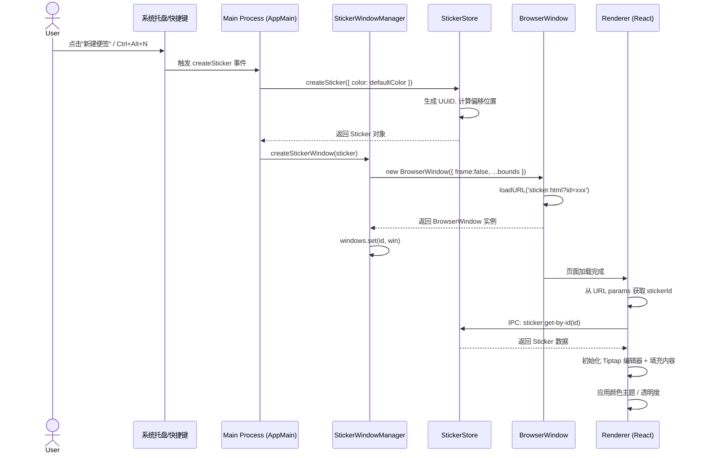
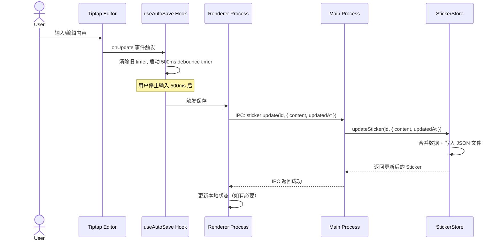
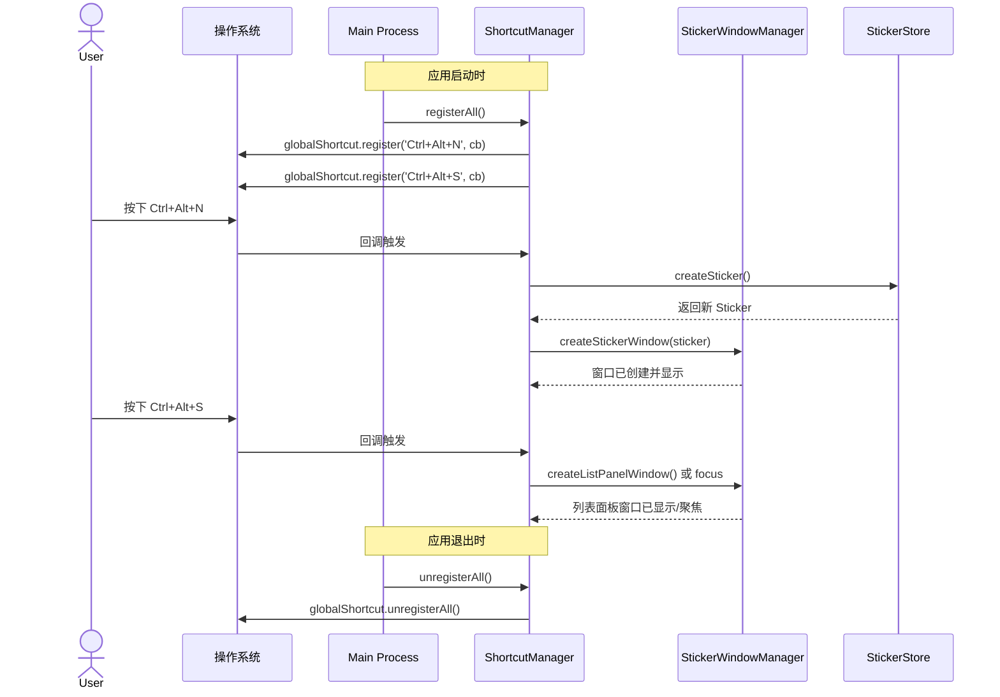
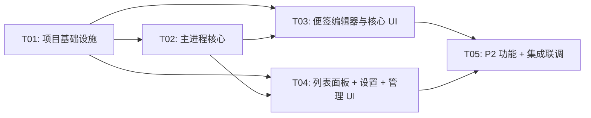

# StickerNote 系统架构设计

> 版本：v1.0 · 架构师：高见远（Gao）· 日期：2026-06-02

---

## 1. 实现方案与框架选型

### 1.1 核心技术挑战

| 挑战 | 说明 | 解决方案 |
|------|------|----------|
| 多窗口管理 | 每张便签为独立 BrowserWindow，需统一创建/销毁/定位 | 主进程 `StickerWindowManager` 集中管理所有窗口实例 |
| 主进程↔渲染进程通信 | contextIsolation 开启，渲染进程无法直接调用 Node API | 通过 `contextBridge` 暴露安全 API，`ipcMain/ipcRenderer` 双向通信 |
| 自动保存防抖 | 停止输入 500ms 后写入，避免频繁 IO | 渲染进程 debounce → IPC → 主进程异步写入 electron-store |
| 窗口位置持久化 | 拖动后位置需保存，重启后恢复 | `window-move` / `window-resize` 事件 → 主进程持久化 `windowState` |
| 全局快捷键 | 不聚焦应用也能触发 | Electron `globalShortcut` API，主进程注册/注销 |
| 富文本内容存储 | HTML 格式持久化 | Tiptap 输出 HTML，electron-store 存储 JSON 字符串 |

### 1.2 框架与库选型

| 框架/库 | 版本 | 用途 | 选型理由 |
|---------|------|------|----------|
| Electron | ^28.x | 桌面应用框架 | `win.setOpacity()` 稳定、`globalShortcut` 行为一致、nativeTheme 完善 |
| React | ^18.2.x | 渲染进程 UI | 组件化开发，生态丰富 |
| Vite | ^5.x | 构建工具 | HMR 极速、Electron 插件支持好 |
| electron-vite | ^2.x | Electron + Vite 集成 | 零配置主进程/渲染进程/预加载脚本构建 |
| @mui/material | ^5.14.x | UI 组件库 | 滑块、对话框、菜单等开箱即用 |
| Tailwind CSS | ^3.4.x | 原子化 CSS | 快速布局与样式微调，与 MUI 互补 |
| @tiptap/react | ^2.x | 富文本编辑器 | 扩展体系完善：Bold/Italic/List/TaskList/History 均有官方扩展 |
| electron-store | ^8.x | 本地持久化 | JSON 存储，支持 schema 校验、加密、默认值 |
| uuid | ^9.x | 便签 ID 生成 | UUID v4，轻量无依赖 |
| dayjs | ^1.11.x | 日期处理 | 轻量（2KB），替代 moment |
| electron-builder | ^24.x | 应用打包 | NSIS 安装包 + 便携版 |

### 1.3 架构模式

采用 **主进程集中式管理 + 渲染进程无状态 UI** 模式：

- **主进程**：拥有所有数据和窗口的控制权，是唯一的数据源（Single Source of Truth）
- **渲染进程**：仅负责 UI 渲染和用户交互，通过 IPC 请求数据和执行操作
- **预加载脚本**：作为安全桥梁，通过 `contextBridge` 暴露受限 API

```
┌─────────────────────────────────────────────────────┐
│                    Main Process                      │
│  ┌──────────────┐ ┌───────────┐ ┌────────────────┐  │
│  │ StickerWindow│ │ Sticker   │ │ GlobalShortcut │  │
│  │ Manager      │ │ Store     │ │ / Tray         │  │
│  └──────┬───────┘ └─────┬─────┘ └───────┬────────┘  │
│         │               │               │           │
│         └───────────────┼───────────────┘           │
│                         │ IPC                       │
│  ┌──────────────────────┼──────────────────────┐    │
│  │              Preload (Bridge)               │    │
│  │        contextBridge.exposeInMainWorld      │    │
│  └──────────────────────┼──────────────────────┘    │
│                         │                           │
│  ┌──────────────────────┼──────────────────────┐    │
│  │          Renderer Process (React)           │    │
│  │  ┌─────────┐ ┌──────────┐ ┌─────────────┐  │    │
│  │  │ Sticker  │ │ Sticker  │ │ Settings    │  │    │
│  │  │ Editor   │ │ List     │ │ Panel       │  │    │
│  │  └─────────┘ └──────────┘ └─────────────┘  │    │
│  └─────────────────────────────────────────────┘    │
└─────────────────────────────────────────────────────┘
```

### 1.4 项目目录结构

```
sticker-note/
├── package.json
├── electron-builder.yml
├── vite.config.ts
├── tsconfig.json
├── tsconfig.node.json
├── tailwind.config.js
├── postcss.config.js
├── index.html
├── resources/                        # 应用图标等静态资源
│   └── icon.ico
├── src/
│   ├── main/                         # 主进程代码
│   │   ├── index.ts                  # 应用入口，生命周期管理
│   │   ├── windows.ts                # BrowserWindow 创建与管理
│   │   ├── store.ts                  # electron-store 封装
│   │   ├── ipc-handlers.ts           # IPC 事件处理器注册
│   │   ├── tray.ts                   # 系统托盘
│   │   ├── shortcuts.ts              # 全局快捷键
│   │   └── reminders.ts              # 提醒调度器
│   ├── preload/                      # 预加载脚本
│   │   └── index.ts                  # contextBridge API 暴露
│   ├── renderer/                    # 渲染进程代码
│   │   ├── main.tsx                  # React 入口
│   │   ├── App.tsx                   # 根组件（路由）
│   │   ├── components/              # UI 组件
│   │   │   ├── StickerEditor.tsx     # 便签编辑器主组件
│   │   │   ├── EditorToolbar.tsx     # 富文本工具栏
│   │   │   ├── ColorPicker.tsx       # 颜色选择器
│   │   │   ├── TagInput.tsx          # 标签输入
│   │   │   ├── TransparencySlider.tsx # 透明度滑块
│   │   │   ├── ReminderPicker.tsx    # 提醒时间选择
│   │   │   ├── StickerTitlebar.tsx    # 便签标题栏（拖拽+操作按钮）
│   │   │   ├── StickerList.tsx       # 便签列表面板
│   │   │   ├── StickerListItem.tsx   # 列表单项
│   │   │   ├── SearchBar.tsx         # 搜索栏
│   │   │   ├── TagFilter.tsx         # 标签过滤器
│   │   │   ├── Settings.tsx          # 设置面板
│   │   │   └── ConfirmDialog.tsx     # 确认对话框
│   │   ├── hooks/                   # React Hooks
│   │   │   ├── useAutoSave.ts       # 自动保存 hook（debounce）
│   │   │   ├── useSticker.ts        # 便签数据读写 hook
│   │   │   └── useTheme.ts          # 深色/浅色模式 hook
│   │   ├── extensions/              # Tiptap 扩展配置
│   │   │   └── index.ts             # 扩展注册与导出
│   │   ├── utils/                   # 工具函数
│   │   │   ├── colors.ts            # 颜色主题定义
│   │   │   └── position.ts          # 窗口定位计算
│   │   └── styles/                  # 样式文件
│   │       ├── globals.css          # 全局样式 + Tailwind 指令
│   │       └── sticker.css          # 便签专用样式
│   └── shared/                      # 主进程与渲染进程共享
│       ├── types.ts                  # 数据类型定义
│       └── ipc-channels.ts          # IPC 通道常量
├── docs/
│   ├── PRD.md
│   ├── ARCHITECTURE.md              # 本文档
│   ├── sequence-diagram.mermaid
│   └── class-diagram.mermaid
└── dist/                            # 构建输出
```

---

## 2. 数据结构与接口

### 2.1 核心数据模型

```typescript
// ============ src/shared/types.ts ============

/** 便签数据模型 */
export interface Sticker {
  id: string;                         // UUID v4
  content: string;                    // HTML 富文本内容
  color: StickerColor;               // 颜色主题
  tags: string[];                     // 标签列表
  isPinned: boolean;                  // 是否置顶
  isVisible: boolean;                 // 是否显示（隐藏=false）
  opacity: number;                    // 透明度 0.2~1.0
  reminder: string | null;           // ISO 8601 提醒时间
  reminderTriggered: boolean;         // 提醒是否已触发
  createdAt: string;                  // ISO 8601 创建时间
  updatedAt: string;                  // ISO 8601 更新时间
  windowState: WindowState;           // 窗口位置与尺寸
}

/** 窗口位置与尺寸 */
export interface WindowState {
  x: number;
  y: number;
  width: number;
  height: number;
}

/** 便签颜色枚举 */
export type StickerColor =
  | '#FFF9C4'  // 黄
  | '#BBDEFB'  // 蓝
  | '#C8E6C9'  // 绿
  | '#F8BBD0'  // 粉
  | '#FFE0B2'  // 橙
  | '#E1BEE7'  // 紫
  | '#FFFFFF'  // 白
  | '#E0E0E0'; // 灰

/** 全局设置模型 */
export interface AppSettings {
  shortcutNew: string;                // 新建便签快捷键
  shortcutList: string;               // 打开列表快捷键
  defaultColor: StickerColor;         // 默认便签颜色
  themeMode: 'system' | 'light' | 'dark'; // 主题模式
  autoStart: boolean;                 // 开机自启动
}

/** 默认设置 */
export const DEFAULT_SETTINGS: AppSettings = {
  shortcutNew: 'Ctrl+Alt+N',
  shortcutList: 'Ctrl+Alt+S',
  defaultColor: '#FFF9C4',
  themeMode: 'system',
  autoStart: false,
};

/** 颜色主题配置 */
export interface ColorTheme {
  name: string;
  color: StickerColor;
  darkColor: string;                  // 深色模式下的背景色
  textColor: string;                  // 文字颜色
}
```

### 2.2 IPC 通道定义

```typescript
// ============ src/shared/ipc-channels.ts ============

/** IPC 通道常量 - 便签操作 */
export const IPC = {
  // 便签 CRUD
  STICKER_CREATE:          'sticker:create',
  STICKER_GET_ALL:          'sticker:get-all',
  STICKER_GET_BY_ID:        'sticker:get-by-id',
  STICKER_UPDATE:           'sticker:update',
  STICKER_DELETE:           'sticker:delete',
  STICKER_TOGGLE_VISIBLE:   'sticker:toggle-visible',
  STICKER_TOGGLE_PIN:       'sticker:toggle-pin',
  STICKER_SET_COLOR:        'sticker:set-color',
  STICKER_SET_OPACITY:      'sticker:set-opacity',
  STICKER_SET_TAGS:         'sticker:set-tags',
  STICKER_SET_REMINDER:     'sticker:set-reminder',

  // 窗口状态
  WINDOW_SAVE_STATE:        'window:save-state',
  WINDOW_CLOSE:             'window:close',         // 隐藏（非销毁）

  // 设置
  SETTINGS_GET:             'settings:get',
  SETTINGS_SET:             'settings:set',

  // 全局操作
  LIST_PANEL_OPEN:           'list-panel:open',
  LIST_PANEL_CLOSE:         'list-panel:close',

  // 数据导入导出
  DATA_EXPORT:              'data:export',
  DATA_IMPORT:              'data:import',

  // 主题
  THEME_GET_CURRENT:       'theme:get-current',
  THEME_CHANGED:           'theme:changed',          // 主进程→渲染进程
} as const;
```

### 2.3 electron-store Schema

```typescript
// ============ src/main/store.ts 中的 schema 定义 ============

const storeSchema = {
  stickers: {
    type: 'array',
    default: [] as Sticker[],
    items: {
      type: 'object',
      properties: {
        id:                { type: 'string' },
        content:           { type: 'string' },
        color:             { type: 'string' },
        tags:              { type: 'array', items: { type: 'string' } },
        isPinned:          { type: 'boolean' },
        isVisible:         { type: 'boolean' },
        opacity:           { type: 'number' },
        reminder:          { type: ['string', 'null'] },
        reminderTriggered: { type: 'boolean' },
        createdAt:         { type: 'string' },
        updatedAt:         { type: 'string' },
        windowState: {
          type: 'object',
          properties: {
            x:      { type: 'number' },
            y:      { type: 'number' },
            width:  { type: 'number' },
            height: { type: 'number' },
          },
        },
      },
    },
  },
  settings: {
    type: 'object',
    default: DEFAULT_SETTINGS,
  },
} as const;
```

### 2.4 类图

```mermaid
classDiagram
    direction TB

    class AppMain {
        -stickerStore: StickerStore
        -windowManager: StickerWindowManager
        -trayManager: TrayManager
        -shortcutManager: ShortcutManager
        -reminderScheduler: ReminderScheduler
        +main(): void
        +onReady(): void
        +onAllWindowsClosed(): void
    }

    class StickerStore {
        -store: ElectronStore
        +getAllStickers(): Sticker[]
        +getStickerById(id): Sticker|null
        +createSticker(partial?): Sticker
        +updateSticker(id, partial): Sticker
        +deleteSticker(id): void
        +getSettings(): AppSettings
        +setSettings(settings): void
        +exportData(): object
        +importData(data, mode): void
    }

    class StickerWindowManager {
        -windows: Map~string,BrowserWindow~
        -listPanelWindow: BrowserWindow|null
        +createStickerWindow(sticker): BrowserWindow
        +hideStickerWindow(id): void
        +showStickerWindow(id): void
        +closeStickerWindow(id): void
        +focusStickerWindow(id): void
        +setStickerAlwaysOnTop(id, pinned): void
        +setStickerOpacity(id, opacity): void
        +createListPanelWindow(): BrowserWindow
        +restoreAllWindows(): void
        +getWindowBounds(id): WindowState
    }

    class TrayManager {
        -tray: Tray
        +createTray(): void
        +updateContextMenu(): void
        +destroy(): void
    }

    class ShortcutManager {
        -settings: AppSettings
        +registerAll(): void
        +unregisterAll(): void
        +updateShortcuts(settings): void
    }

    class ReminderScheduler {
        -timers: Map~string,NodeJS.Timeout~
        +scheduleAllReminders(): void
        +scheduleReminder(sticker): void
        +cancelReminder(id): void
        +sendNotification(sticker): void
    }

    class IpcHandlerRegistry {
        -store: StickerStore
        -windowManager: StickerWindowManager
        +registerAll(): void
        -handleStickerCreate(event, data): Sticker
        -handleStickerUpdate(event, data): Sticker
        -handleStickerDelete(event, id): void
        -handleWindowSaveState(event, data): void
        -handleSettingsGet(event): AppSettings
        -handleSettingsSet(event, settings): void
    }

    class PreloadAPI {
        +sticker: StickerAPI
        +window: WindowAPI
        +settings: SettingsAPI
        +theme: ThemeAPI
        +data: DataAPI
    }

    class StickerAPI {
        +create(partial?): Promise~Sticker~
        +getAll(): Promise~Sticker[]~
        +getById(id): Promise~Sticker~
        +update(id, partial): Promise~Sticker~
        +delete(id): Promise~void~
        +toggleVisible(id): Promise~Sticker~
        +togglePin(id): Promise~Sticker~
        +setColor(id, color): Promise~Sticker~
        +setOpacity(id, opacity): Promise~Sticker~
        +setTags(id, tags): Promise~Sticker~
        +setReminder(id, reminder): Promise~Sticker~
    }

    class WindowAPI {
        +saveState(state): Promise~void~
        +close(): Promise~void~
    }

    class SettingsAPI {
        +get(): Promise~AppSettings~
        +set(settings): Promise~void~
    }

    class ThemeAPI {
        +getCurrent(): Promise~string~
        +onChanged(callback): void
    }

    class DataAPI {
        +export(): Promise~object~
        +import(data, mode): Promise~void~
    }

    AppMain --> StickerStore : 拥有
    AppMain --> StickerWindowManager : 拥有
    AppMain --> TrayManager : 拥有
    AppMain --> ShortcutManager : 拥有
    AppMain --> ReminderScheduler : 拥有
    IpcHandlerRegistry --> StickerStore : 使用
    IpcHandlerRegistry --> StickerWindowManager : 使用
    PreloadAPI --> StickerAPI : 包含
    PreloadAPI --> WindowAPI : 包含
    PreloadAPI --> SettingsAPI : 包含
    PreloadAPI --> ThemeAPI : 包含
    PreloadAPI --> DataAPI : 包含
```



---

## 3. 程序调用流程

### 3.1 新建便签流程



### 3.2 自动保存流程



### 3.3 全局快捷键响应流程



---

## 4. 依赖包列表

### 4.1 生产依赖 (dependencies)

```
electron@^28.2.0               : 桌面应用框架
react@^18.2.0                  : UI 框架
react-dom@^18.2.0              : React DOM 渲染
@mui/material@^5.15.0          : UI 组件库
@mui/icons-material@^5.15.0    : MUI 图标库
@emotion/react@^11.11.0        : MUI 样式引擎
@emotion/styled@^11.11.0        : MUI 样式引擎
@tiptap/react@^2.2.0           : Tiptap React 绑定
@tiptap/starter-kit@^2.2.0     : Tiptap 基础扩展包（Bold/Italic/List/History）
@tiptap/extension-task-list@^2.2.0  : Tiptap 待办清单扩展
@tiptap/extension-task-item@^2.2.0  : Tiptap 待办项扩展
@tiptap/extension-text-style@^2.2.0 : Tiptap 字号样式扩展
@tiptap/pm@^2.2.0              : Tiptap ProseMirror 核心
electron-store@^8.1.0          : 本地 JSON 存储
uuid@^9.0.0                    : UUID 生成
dayjs@^1.11.10                 : 日期处理
```

### 4.2 开发依赖 (devDependencies)

```
electron-builder@^24.9.0       : 应用打包
electron-vite@^2.1.0           : Electron + Vite 集成
vite@^5.4.0                    : 构建工具
typescript@^5.3.0              : TypeScript 编译
@types/react@^18.2.0           : React 类型
@types/react-dom@^18.2.0       : React DOM 类型
@vitejs/plugin-react@^4.2.0    : Vite React 插件
tailwindcss@^3.4.0             : 原子化 CSS
postcss@^8.4.0                 : CSS 处理
autoprefixer@^10.4.0           : CSS 前缀
@types/uuid@^9.0.0             : UUID 类型
eslint@^8.56.0                 : 代码检查
```

---

## 5. 任务列表

### T01: 项目基础设施

**描述**：搭建项目骨架，配置所有构建工具、依赖声明和入口文件，确保项目可启动。

**涉及文件**：
- `package.json` — 项目元信息、依赖声明、npm scripts
- `electron-builder.yml` — 打包配置
- `vite.config.ts` — Vite 构建配置（主进程/渲染进程/预加载）
- `tsconfig.json` + `tsconfig.node.json` — TypeScript 配置
- `tailwind.config.js` — Tailwind CSS 配置
- `postcss.config.js` — PostCSS 配置
- `index.html` — 渲染进程 HTML 入口
- `resources/icon.ico` — 应用图标
- `src/main/index.ts` — 主进程入口（app 生命周期骨架）
- `src/preload/index.ts` — 预加载脚本（contextBridge 骨架）
- `src/renderer/main.tsx` — React 入口
- `src/renderer/App.tsx` — 根组件
- `src/renderer/styles/globals.css` — 全局样式 + Tailwind 指令
- `src/shared/types.ts` — 共享类型定义
- `src/shared/ipc-channels.ts` — IPC 通道常量

**依赖**：无

**优先级**：P0

---

### T02: 主进程核心

**描述**：实现主进程全部模块——数据存储、窗口管理、IPC 通信、系统托盘、全局快捷键。

**涉及文件**：
- `src/main/store.ts` — StickerStore 封装（electron-store + schema + CRUD）
- `src/main/windows.ts` — StickerWindowManager（创建/隐藏/显示/置顶/透明度/列表窗口）
- `src/main/ipc-handlers.ts` — IpcHandlerRegistry（注册全部 IPC handler）
- `src/main/tray.ts` — TrayManager（系统托盘 + 右键菜单）
- `src/main/shortcuts.ts` — ShortcutManager（全局快捷键注册/注销）
- `src/main/reminders.ts` — ReminderScheduler（提醒调度 + Notification）
- `src/preload/index.ts` — 完善 contextBridge API 暴露（StickerAPI/WindowAPI/SettingsAPI/ThemeAPI/DataAPI）

**依赖**：T01

**优先级**：P0

---

### T03: 便签编辑器与核心 UI 组件

**描述**：实现便签窗口的渲染进程——富文本编辑器、工具栏、颜色选择、自动保存、窗口标题栏拖拽等 P0 核心 UI。

**涉及文件**：
- `src/renderer/components/StickerEditor.tsx` — 便签编辑器主组件（加载 Tiptap + 颜色/标签/置顶/透明度）
- `src/renderer/components/EditorToolbar.tsx` — 富文本工具栏（加粗/斜体/列表/字号/Todo）
- `src/renderer/components/ColorPicker.tsx` — 颜色选择器（8 色）
- `src/renderer/components/StickerTitlebar.tsx` — 自定义标题栏（拖拽移动 + 操作按钮）
- `src/renderer/components/TransparencySlider.tsx` — 透明度滑块（20%~100%）
- `src/renderer/components/TagInput.tsx` — 标签输入组件
- `src/renderer/components/ConfirmDialog.tsx` — 确认对话框（删除确认等）
- `src/renderer/extensions/index.ts` — Tiptap 扩展配置（StarterKit + TaskList + TextStyle + FontSize）
- `src/renderer/hooks/useAutoSave.ts` — 自动保存 hook（500ms debounce + IPC 调用）
- `src/renderer/hooks/useSticker.ts` — 便签数据读写 hook
- `src/renderer/hooks/useTheme.ts` — 深色/浅色模式 hook
- `src/renderer/utils/colors.ts` — 颜色主题定义（8色 + 深色模式映射）
- `src/renderer/utils/position.ts` — 窗口偏移定位计算
- `src/renderer/styles/sticker.css` — 便签专用样式（圆角、无框、拖拽区域）

**依赖**：T01, T02

**优先级**：P0

---

### T04: 列表面板 + 设置 + 管理 UI

**描述**：实现便签列表面板（搜索/过滤/操作）、设置面板（快捷键/主题/导入导出）及所有 P1 管理 UI。

**涉及文件**：
- `src/renderer/components/StickerList.tsx` — 便签列表面板（展示所有便签 + 搜索 + 右键菜单）
- `src/renderer/components/StickerListItem.tsx` — 列表单项（颜色圆点 + 标题 + 日期 + 状态）
- `src/renderer/components/SearchBar.tsx` — 搜索栏（实时全文搜索）
- `src/renderer/components/TagFilter.tsx` — 标签过滤器
- `src/renderer/components/Settings.tsx` — 设置面板（快捷键自定义/默认颜色/主题/自启动/导入导出）
- `src/renderer/components/ReminderPicker.tsx` — 提醒时间选择器

**依赖**：T01, T02

**优先级**：P1

---

### T05: P2 功能 + 集成联调 + 最终优化

**描述**：实现 P2 功能（深色模式完善、待办清单、导入导出、提醒）、全局样式打磨、所有功能联调与优化。

**涉及文件**：
- `src/renderer/extensions/index.ts` — 补充 TaskList/TaskItem 扩展完善
- `src/renderer/hooks/useTheme.ts` — 完善深色/浅色/跟随系统切换逻辑
- `src/renderer/styles/globals.css` — 深色模式全局样式
- `src/renderer/styles/sticker.css` — 便签深色模式样式
- `src/renderer/App.tsx` — 路由整合（sticker / list / settings 页面）
- `src/main/index.ts` — 应用启动流程完善（恢复窗口、注册提醒等）
- `src/main/reminders.ts` — 完善提醒调度与 Notification
- `src/main/store.ts` — 完善导入导出逻辑

**依赖**：T03, T04

**优先级**：P2

---

## 6. 任务依赖图



---

## 7. 共享知识（跨文件约定）

### 7.1 编码规范

- **语言**：TypeScript strict 模式，所有代码必须通过类型检查
- **组件风格**：React 函数组件 + Hooks，禁止 Class Component
- **状态管理**：组件本地 `useState` / `useReducer`，无需引入 Redux（便签数据全在主进程，渲染进程无全局状态）
- **样式方案**：Tailwind CSS 为主（布局/间距/字号），MUI 组件自带样式（按钮/滑块/对话框等），`sticker.css` 仅处理无法用 Tailwind 实现的效果（如 `-webkit-app-region: drag`）

### 7.2 命名约定

| 类别 | 约定 | 示例 |
|------|------|------|
| 文件名 | PascalCase（组件）、camelCase（工具/配置） | `StickerEditor.tsx`, `colors.ts` |
| CSS 类名 | Tailwind 原子类为主，自定义类用 kebab-case | `sticker-window`, `titlebar-drag` |
| IPC 通道 | `域名:动作` 格式，全小写，冒号分隔 | `sticker:create`, `window:save-state` |
| 数据字段 | camelCase | `isPinned`, `windowState` |
| 常量 | UPPER_SNAKE_CASE | `DEFAULT_SETTINGS`, `IPC` |
| 类型/接口 | PascalCase | `Sticker`, `AppState`, `WindowAPI` |

### 7.3 IPC 通信规范

- **渲染→主进程**：使用 `ipcRenderer.invoke()` / `contextBridge` 暴露的 Promise API（支持返回值）
- **主进程→渲染进程**：使用 `win.webContents.send()`（如主题变更通知）
- **所有 IPC 调用必须通过 preload 暴露的 API**，禁止渲染进程直接访问 `ipcRenderer`

### 7.4 便签 ID 传递

- 新建便签窗口时，通过 URL query parameter `?id=xxx` 传递便签 ID
- 渲染进程从 `window.location.search` 解析 ID
- 列表面板通过 IPC 获取全量数据，无需 URL 参数

### 7.5 窗口边界约束

- 便签窗口最小尺寸：160 × 120px
- 默认尺寸：240 × 200px
- 新建便签偏移：相对上一张便签偏移 (20, 20)px
- 窗口位置保存时机：`move` 和 `resize` 事件 300ms debounce 后 IPC 通知主进程

### 7.6 时间格式

- 所有时间字段使用 **ISO 8601 UTC 格式**：`2026-06-01T10:00:00.000Z`
- 前端显示使用 `dayjs.format('YYYY-MM-DD HH:mm')`

---

## 8. 待明确事项

| # | 问题 | 假设/建议 | 影响范围 |
|---|------|----------|----------|
| 1 | Q1: 是否需要云同步？ | MVP 仅本地存储，StickerStore 接口预留远程同步扩展点 | 数据层 |
| 2 | Q2: 最大便签数量限制？ | 建议上限 200 张，超过时列表面板分页 | 性能 |
| 3 | Q3: 富文本是否支持图片粘贴？ | MVP 不支持图片，Tiptap Image 扩展留作 v1.1 | 存储体积 |
| 4 | Q4: P2 功能排期？ | 架构设计已包含 P2 全部功能，建议按优先级迭代开发 | 排期 |
| 5 | Q5: 全局快捷键冲突？ | 启动时检测冲突并提示，设置面板允许自定义快捷键 | F-10 |
| 6 | Q6: 多语言支持？ | MVP 仅简体中文，所有用户可见文案集中管理便于后续 i18n | UI 全局 |
| 7 | 列表面板是否独立窗口？ | 是，列为独立 BrowserWindow（非便签窗口内弹出），尺寸 320×600 | 窗口管理 |
| 8 | 便签内容为空时是否自动删除？ | 新建便签如内容为空且用户主动隐藏，标记为 `isEmpty` 但不自动删除 | 数据管理 |

---

*文档结束 · 架构师：高见远（Gao）*
